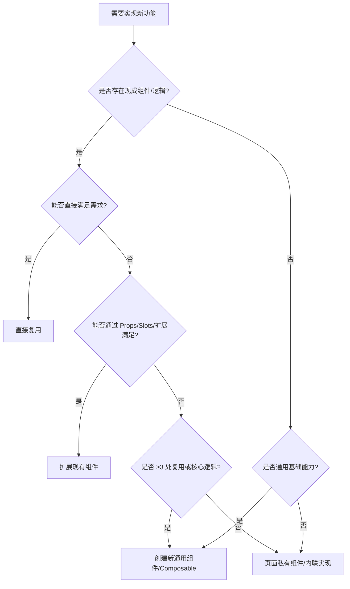

# 04 开发原则：组件拆分、注释、复用、改造边界、实现原则

> 版本: v1.0
> 最后更新: 2026-11-19
> 维护: 前端架构组
> 核心理念: **单一职责、高内聚低耦合、约定优于配置、显式优于隐式**

---

## 1. 组件拆分原则

### 1.1 拆分维度与判断标准

| 维度 | 拆分条件 | 目标粒度 | 示例 |
|------|----------|----------|------|
| **复用性** | ≥3 处使用或未来明确复用计划 | 通用组件库 (`src/components/`) | `Table`, `Dialog`, `Pagination`, `JsonViewer` |
| **业务内聚** | 仅在特定业务域内使用，逻辑紧密 | 页面私有组件 (`views/{domain}/components/`) | `InterfaceForm`, `DataSourceSqlEditor` |
| **复杂度** | 单文件 > 300 行 或 单函数 > 50 行 | 拆分为子组件/组合式函数 | `TaskCreate` → `StepForm`, `FormInfo`, `useTaskCreate` |
| **变更频率** | 变更原因不同 (UI/业务/数据) | 按变更原因拆分 | 表格列渲染 vs 数据获取 vs 分页逻辑 |
| **测试需求** | 核心逻辑需独立单测 | 组合式函数 (`composables/`) | `useTable`, `useForm`, `usePermission` |

### 1.2 组件层级架构

```
┌─────────────────────────────────────────────────────────────┐
│ 页面 Page (views/xxx/index.vue)                              │
│   ├── 路由入口、页面级状态、生命周期、业务编排               │
└─────────────────────┬───────────────────────────────────────┘
                      │ 组合/调用
        ┌─────────────┼─────────────┐
        ▼             ▼             ▼
┌───────────────┐ ┌───────────────┐ ┌───────────────┐
│ 通用组件库     │ │ 业务组件       │ │ 组合式函数     │
│ src/components/│ │ views/xxx/    │ │ composables/  │
│                │ │   components/ │ │               │
│ Layout         │ │ InterfaceForm │ │ useTable      │
│ Table          │ │ SqlEditor     │ │ useForm       │
│ Dialog         │ │ StepForm      │ │ useDebounce   │
│ Pagination     │ │ ...           │ │ usePermission │
└───────────────┘ └───────────────┘ └───────────────┘
        │             │             │
        └─────────────┼─────────────┘
                      ▼
         ┌───────────────────────┐
         │ 基础设施层             │
         │ utils/  config/       │
         │ request.js  mitt.js   │
         │ date.js   const.js    │
         └───────────────────────┘
```

### 1.3 组件通信模式

| 场景 | 推荐模式 | 示例 |
|------|----------|------|
| **父 → 子** | Props (单向数据流) | `<Table :data="tableData" :total="total" />` |
| **子 → 父** | Emits (事件) | `@pageDataChange="pageDataChange"` |
| **兄弟/跨层级** | mitt 事件总线 (慎用) | `emitter.emit('logout')` → `router.push('/login')` |
| **全局状态** | Pinia Store | `useUserStore()`, `useInterfaceStore()` |
| **URL 状态** | Router Query/Params | `router.push({ query: { id } })` |
| **插槽内容分发** | Slots (具名/作用域) | `<Table><template #default="scope">...</template></Table>` |
| **依赖注入** | provide/inject (深层组件) | 主题配置、权限上下文、表单上下文 |

---

## 2. 组合式函数设计规范

### 2.1 标准结构

```javascript
// composables/useTable.js
import { ref, computed, onMounted, onUnmounted } from 'vue'
import { ElMessage } from 'element-plus'

/**
 * 表格通用逻辑封装
 * @param {Object} options 配置选项
 * @param {Function} options.apiFn API 调用函数，返回 Promise<{list, total}>
 * @param {Object} options.defaultParams 默认查询参数
 * @param {Boolean} options.immediate 是否立即加载
 * @returns {Object} 表格状态与方法
 */
export function useTable(options = {}) {
  const { apiFn, defaultParams = {}, immediate = true } = options
  
  // ========== State ==========
  const tableData = ref([])
  const total = ref(0)
  const loading = ref(false)
  const pageData = ref({ pageNum: 1, pageSize: 10 })
  const queryParams = ref({ ...defaultParams })
  const multipleSelection = ref([])
  
  // ========== Computed ==========
  const hasSelection = computed(() => multipleSelection.value.length > 0)
  
  // ========== Methods ==========
  const loadData = async () => {
    loading.value = true
    try {
      const params = { ...pageData.value, ...queryParams.value }
      const res = await apiFn(params)
      tableData.value = res.list || []
      total.value = res.total || 0
    } catch (error) {
      ElMessage.error('加载失败')
      tableData.value = []
      total.value = 0
    } finally {
      loading.value = false
    }
  }
  
  const handlePageChange = (val) => {
    pageData.value = val
    loadData()
  }
  
  const handleSelectionChange = (val) => {
    multipleSelection.value = val
  }
  
  const handleSearch = (newParams) => {
    queryParams.value = { ...queryParams.value, ...newParams }
    pageData.value.pageNum = 1
    loadData()
  }
  
  const handleReset = () => {
    queryParams.value = { ...defaultParams }
    pageData.value.pageNum = 1
    loadData()
  }
  
  const refresh = () => loadData()
  
  // ========== Lifecycle ==========
  if (immediate) {
    onMounted(() => loadData())
  }
  
  // ========== Return ==========
  return {
    // State
    tableData,
    total,
    loading,
    pageData,
    queryParams,
    multipleSelection,
    // Computed
    hasSelection,
    // Methods
    loadData,
    handlePageChange,
    handleSelectionChange,
    handleSearch,
    handleReset,
    refresh
  }
}
```

### 2.2 设计原则

| 原则 | 要求 | 正例 | 反例 |
|------|------|------|------|
| **单一职责** | 一个 composable 只做一类事 | `useTable`, `useForm`, `useDebounce` | `useTableAndFormAndModal` |
| **无副作用初始化** | 不在顶层执行异步/副作用 | `onMounted` 中调用 `loadData()` | 顶层 `await apiFn()` |
| **返回响应式对象** | 保持 `ref`/`reactive` 响应性 | `return { tableData, total, loadData }` | `return { tableData: tableData.value }` |
| **可选参数配置化** | 通过 options 对象扩展 | `useTable({ apiFn, immediate: false })` | 硬编码 API 路径 |
| **类型友好** | 导出 TypeScript 类型 | `export type UseTableReturn = ...` | 无类型定义 |
| **可测试性** | 纯函数分离、依赖注入 | `apiFn` 作为参数传入 | 直接 `import request from '@/api/...'` |

---

## 3. 注释规范

### 3.1 文件头注释 (必须)

```vue
<!--
  @file InterfaceManage.vue
  @description 接口管理列表页 - 查询、新增、编辑、删除、导入导出
  @author 前端架构组
  @created 2026-11-19
  @updated 2026-11-19
  @version 1.0
-->
```

### 3.2 组件/函数 JSDoc 注释 (必须)

```vue
<script setup>
/**
 * 标准列表页表格组件
 * @component Table
 * @props {Array} data - 表格数据源
 * @props {Number} total - 总记录数
 * @props {Boolean} loading - 加载状态
 * @emits pageDataChange - 分页变化 {currentPage, pageSize}
 * @emits selectionChange - 选择变化 Array<Row>
 * @slot default - el-table-column 列定义
 * @example
 * <Table :data="list" :total="total" @pageDataChange="onPageChange">
 *   <el-table-column prop="name" label="名称" />
 * </Table>
 */
defineOptions({ name: 'Table' })
// ...
</script>
```

```javascript
// composables/useTable.js
/**
 * 表格通用逻辑 Hook
 * @param {Object} options
 * @param {Function} options.apiFn - API 调用，参数 {pageNum, pageSize, ...query}，返回 {list, total}
 * @param {Object} [options.defaultParams={}] - 默认查询参数
 * @param {Boolean} [options.immediate=true] - 是否挂载即加载
 * @returns {UseTableReturn} 表格状态与操作方法
 */
export function useTable(options) { ... }
```

### 3.3 关键业务逻辑行内注释

```javascript
// 业务规则：接口编码唯一性校验，编辑时排除自身
const checkCodeUnique = async (code, excludeId) => {
  // 调用后端唯一性校验接口
  const res = await validateInterfaceCode({ code, excludeId })
  return res.data?.valid === true
}

// 状态流转：仅允许 启用(1)→禁用(0)，禁用→启用需走审批流
const toggleStatus = (row) => {
  if (row.status === '0') {
    // 禁用→启用：弹窗确认 + 审批单据号
    showApprovalDialog(row)
  } else {
    // 启用→禁用：直接确认
    confirmDisable(row)
  }
}
```

### 3.4 类型定义注释

```typescript
// types/interface.d.ts

/** 接口管理 - 列表项 */
export interface InterfaceListItem {
  /** 接口唯一编码 (业务主键) */
  interfaceCode: string
  /** 接口名称 */
  interfaceName: string
  /** 接口描述 */
  interfaceDescription: string
  /** API 地址 */
  address: string
  /** 状态: 1-启用, 0-禁用 */
  status: '1' | '0'
  /** 创建时间 ISO 字符串 */
  createTime: string
}

/** 分页查询参数 */
export interface InterfaceQueryParams extends PageParams {
  /** 接口名称模糊查询 */
  interfaceName?: string
  /** 状态筛选 */
  status?: '1' | '0'
  /** 数据源 ID */
  dataSourceId?: string
}
```

### 3.5 注释密度标准

| 代码类型 | 注释要求 |
|----------|----------|
| **组件文件** | 文件头 + 组件 JSDoc + 关键 Props/Emits/Slots + 复杂逻辑行内 |
| **Composable** | 文件头 + 函数 JSDoc + 返回值类型 + 核心算法行内 |
| **API 封装** | 文件头 + 每个导出函数 JSDoc (参数、返回、错误码) |
| **工具函数** | 函数 JSDoc + 复杂正则/算法行内 |
| **Store** | 文件头 + State/Getter/Action JSDoc + 业务规则行内 |
| **路由配置** | 关键路由 meta 说明、特殊守卫逻辑行内 |

---

## 4. 复用策略与实践

### 4.1 复用决策树



### 4.2 复用层级与优先级

| 层级 | 目录 | 复用范围 | 维护责任 | 变更流程 |
|------|------|----------|----------|----------|
| **L1: 通用组件库** | `src/components/` | 全项目 | 架构组 | PR + 评审 + 文档同步 |
| **L2: 业务共享组件** | `views/{domain}/components/` | 单业务域多页面 | 业务组 | 业务组内评审 |
| **L3: 页面私有组件** | `views/{domain}/components/` (单页面目录) | 单页面 | 页面开发者 | 自行维护 |
| **L4: 通用逻辑** | `composables/` | 全项目 | 架构组 | PR + 评审 + 单测 |
| **L5: 业务逻辑** | `views/{domain}/hooks/` | 单业务域 | 业务组 | 业务组内评审 |
| **L6: 页面内联** | `views/{domain}/index.vue` | 单页面 | 页面开发者 | 自行维护 |

### 4.3 复用禁忌

| 禁忌 | 后果 | 替代方案 |
|------|------|----------|
| **过度抽象** | 组件 Props 爆炸、插槽嵌套地狱、无人敢改 | 保留适度重复，优先复制改造 |
| **跨域强行复用** | 业务耦合、改一处坏多处 | 业务域隔离，共享仅限基础设施 |
| **复制粘贴不重构** | Bug 修复需同步多处、风格分化 | 识别出 ≥3 处复用时及时提取 |
| **私自引入外部库** | 依赖膨胀、风格不一、安全风险 | 需求提交架构组评审选型 |

---

## 5. 改造边界与重构原则

### 5.1 何时重构 (触发条件)

| 触发条件 | 优先级 | 处理方式 |
|----------|--------|----------|
| **Bug 反复出现** (同一模块 >3 次) | P0 | 立即重构，补充单测覆盖 |
| **新需求无法在现有架构干净实现** | P1 | 评估重构范围，制定计划，分步实施 |
| **代码复杂度超标** (圈复杂度 >20、文件 >500 行) | P1 | 拆分组件/Composable，消除神类 |
| **技术债务阻塞新功能** | P1 | 纳入迭代计划，分配专人偿还 |
| **性能瓶颈** (渲染 >500ms、包体积超标) | P2 | 性能分析定向优化 |
| **代码风格不一致** (新旧混用) | P2 | 统一规范，增量迁移 |

### 5.2 重构红线 (必须遵守)

| 红线 | 说明 |
|------|------|
| **不重构无测试覆盖的核心逻辑** | 先补单测，再重构，确保行为不变 |
| **不一次性大范围重构** | 单次 PR 变更 ≤ 300 行，拆分多个小 PR |
| **不破坏现有 API 契约** | Props/Emits/Store 接口保持向后兼容，废弃期 ≥ 2 个版本 |
| **不在业务迭代期混入重构** | 重构与功能开发分离，专门分配技术迭代时间 |
| **不重构稳定、低变更、无扩展需求的代码** | ROI 为负，遵循"不坏不动" |

### 5.3 重构标准流程

```
1. 识别痛点 → 2. 制定方案 → 3. 评审确认 → 4. 搭建脚手架/测试 → 5. 增量迁移 → 6. 灰度验证 → 7. 旧代码清理 → 8. 文档同步
```

---

## 6. 实现原则 (代码级)

### 6.1 Vue 3 Composition API 最佳实践

```vue
<script setup>
/* ========== 1. 导入与类型 ========== */
import { ref, reactive, computed, onMounted, onUnmounted, watch } from 'vue'
import type { InterfaceListItem, InterfaceQueryParams } from '@/types/interface'

/* ========== 2. Props 与 Emits 定义 ========== */
const props = defineProps<{
  /** 初始查询参数 */
  initialParams?: Partial<InterfaceQueryParams>
}>()

const emit = defineEmits<{
  (e: 'row-click', row: InterfaceListItem): void
  (e: 'selection-change', rows: InterfaceListItem[]): void
}>()

/* ========== 3. 响应式状态 (按类型分组) ========== */
// 数据状态
const tableData = ref<InterfaceListItem[]>([])
const total = ref(0)
const loading = ref(false)

// 表单/查询状态
const queryForm = reactive<InterfaceQueryParams>({
  pageNum: 1,
  pageSize: 10,
  ...props.initialParams
})

// UI 状态
const dialogVisible = ref(false)
const multipleSelection = ref<InterfaceListItem[]>([])

/* ========== 4. 计算属性 ========== */
const hasSelection = computed(() => multipleSelection.value.length > 0)
const statusOptions = computed(() => [
  { label: '启用', value: '1' },
  { label: '禁用', value: '0' }
])

/* ========== 5. 方法 (按功能分组，事件处理用 handle 前缀) ========== */
// 数据获取
const fetchList = async () => { ... }

// 事件处理
const handleSearch = () => { ... }
const handleReset = () => { ... }
const handlePageChange = (val) => { ... }
const handleSelectionChange = (val) => { ... }
const handleRowClick = (row) => { emit('row-click', row) }

// 弹窗操作
const handleAdd = () => { ... }
const handleEdit = (row) => { ... }
const handleDelete = (row) => { ... }
const handleDialogSure = () => { ... }
const handleDialogCancel = () => { ... }

/* ========== 6. 监听与生命周期 ========== */
watch(() => props.initialParams, (newVal) => {
  Object.assign(queryForm, newVal)
  fetchList()
}, { deep: true })

onMounted(() => { fetchList() })

onUnmounted(() => { 
  // 清理定时器、事件监听、订阅
  emitter.off('logout', handleLogout)
})

/* ========== 7. 模板引用暴露 (如需) ========== */
defineExpose({
  refresh: fetchList,
  getSelectedRows: () => multipleSelection.value
})
</script>
```

### 6.2 代码组织顺序 (统一风格)

```
<script setup>
1. 导入 (外部库 → 内部绝对路径 @/ → 相对路径 ./)
2. 类型导入 (import type)
3. Props 定义 (defineProps + 类型/校验)
4. Emits 定义 (defineEmits + 类型)
5. 响应式状态 (ref/reactive/computed, 按数据/UI/表单分组)
6. 方法定义 (数据获取 → 事件处理 → 业务逻辑 → 工具方法)
7. 监听器
8. 生命周期钩子
9. 依赖注入
10. 暴露
</script>

<template>
<!-- 模板结构: 容器 → 头部/工具栏 → 查询/表单 → 主内容(表格/详情) → 弹窗/抽屉 -->
</template>

<style scoped lang="less/scss">
/* 1. 根容器布局
   2. 子区域样式
   3. 状态修饰符
   4. 响应式断点
   5. :deep() 组件库覆盖 */
</style>
```

### 6.3 错误处理规范

```javascript
// 统一错误处理模式
const handleApiCall = async (apiFn, successMsg, errorMsg) => {
  try {
    loading.value = true
    const res = await apiFn()
    ElMessage.success(successMsg || '操作成功')
    return res
  } catch (error) {
    // request.js 拦截器已处理 401/网络错误，此处仅业务错误
    console.error(errorMsg || '操作失败', error)
    ElMessage.error(error?.message || errorMsg || '操作失败')
    throw error // 保持 Promise 拒绝，供调用链处理
  } finally {
    loading.value = false
  }
}

// 使用示例
const handleDelete = async (row) => {
  try {
    await ElMessageBox.confirm('确定删除？', '提示', { type: 'warning' })
    await handleApiCall(
      () => deleteInterface(row.interfaceCode),
      '删除成功',
      '删除失败'
    )
    fetchList()
  } catch {
    // 用户取消或删除失败，静默处理
  }
}
```

### 6.4 性能优化清单

| 优化点 | 实现方式 | 适用场景 |
|--------|----------|----------|
| **路由懒加载** | `component: () => import('@/views/xxx')` | 所有非首页路由 |
| **组件缓存** | `<router-view v-slot="{ Component }"><keep-alive><component :is="Component" /></keep-alive></router-view>` | 列表页、表单页、高频切换页 |
| **虚拟滚动** | `el-table` + `virtual-scroll` 或第三方 | 单页 > 100 行、大数据量 |
| **防抖/节流** | `useDebounce`, `useThrottle` composable | 搜索输入、窗口resize、滚动加载 |
| **按需引入** | `import { ElButton } from 'element-plus'` (自动) | 所有 Element Plus 组件 |
| **异步组件** | `defineAsyncComponent(() => import('./HeavyComponent'))` | 大型图表、编辑器、非首屏弹窗 |
| **计算属性缓存** | `computed` 替代 `methods` | 派生数据、过滤排序 |
| **v-once / v-memo** | 静态内容、大列表行渲染优化 | 纯展示组件、列表行 |

---

## 7. 代码审查自查清单 (提交前自查)

### 7.1 架构与设计
- [ ] 组件职责单一，无"神组件"
- [ ] 复用层级正确 (L1-L6)，无跨域强耦合
- [ ] Composables 无副作用初始化，依赖注入而非硬编码
- [ ] 状态管理分层正确 (全局/页面/URL/缓存)
- [ ] 组件通信模式规范 (Props/Emits/Slots/Store/EventBus)

### 7.2 代码质量
- [ ] 文件头注释、组件/函数 JSDoc 完整
- [ ] 关键业务逻辑有行内注释
- [ ] TypeScript 类型完整，无 `any` (除非必要并有说明)
- [ ] 命名规范符合 `02-naming.md`
- [ ] 无死代码、无控制台 `console.log` (开发调试除外)
- [ ] 错误处理完整，用户有感知反馈

### 7.3 Vue 规范
- [ ] `<script setup>` 代码组织顺序规范
- [ ] Props 定义类型 + 默认值 + 必填校验
- [ ] Emits 定义类型
- [ ] 响应式 API 正确使用 (`ref`/`reactive`/`computed`/`watch`)
- [ ] 生命周期清理完整 (`onUnmounted` 移除监听/定时器)
- [ ] 模板无复杂表达式 (移至 computed/methods)
- [ ] `v-for` 必有 `:key`，且 key 稳定唯一

### 7.4 UI 与体验
- [ ] 复用标准组件 (Table/Dialog/Pagination/ListLayout)
- [ ] 按钮/表单/表格/弹窗符合 `03-ui-standards.md`
- [ ] Loading/空状态/错误状态全覆盖
- [ ] 响应式断点适配，无横向溢出
- [ ] 基础 a11y: 语义标签、键盘可达、焦点可见

### 7.5 性能与安全
- [ ] 路由懒加载、大组件异步加载
- [ ] 无敏感信息硬编码 (Token、密钥、内网地址)
- [ ] XSS 防护: 用户输入内容渲染用 `v-text` 或 `{{}}`，禁用 `v-html` (除非经过 sanitize)
- [ ] 权限控制: 按钮级 `v-permission`、路由守卫、API 返回字段权限

---

## 8. 变更记录

| 版本 | 日期 | 变更人 | 变更内容 |
|------|------|--------|----------|
| v1.0 | 2026-11-19 | 前端架构组 | 初版：组件拆分、Composable设计、注释规范、复用策略、改造边界、实现原则、自查清单 |

---

> **执行建议**：将本文档第 7 节"代码审查自查清单"制作为 PR 模板 (`.github/pull_request_template.md`)，强制提交者勾选。新人入职第一周必读本文档并通过实战演练考核。